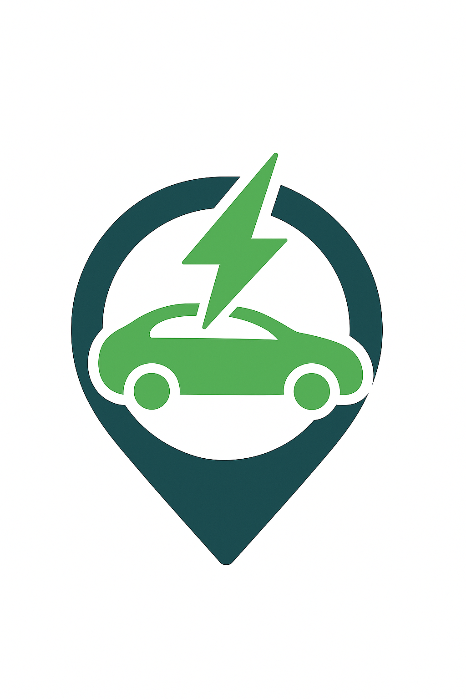

[](https://www.python.org) [](https://github.com/pre-commit/pre-commit) [](https://github.com/psf/black) [](http://www.pydocstyle.org/en/stable/)

<p align="center">
  
</p>

<h1 align="center">EV Model Simulator (Prototype)</h1>

Lightweight FastAPI prototype to simulate EV battery consumption, charging curve behavior, and range prediction between two geographic points—optimized for Egyptian EV adoption scenarios 🇪🇬🚗🔋.

## ⚙️ Installation

Clone the repository:

```bash
$ git clone https://github.com/danaelshrbiny10/Electrical-Vehicles.git
$ cd Electrical-Vehicles
$ python3 -m venv .env
$ source .env/bin/activate
```

Set up environment variables:

```bash
$ cp .env.template .env
```

## :snake: Python Requirements

Within your preferred Python environment, run the following to set up the project:

Using `pip`

```bash

$ pip install -r requirements.txt
```

## 🚀 Run the FastAPI Server

Start the application with Uvicorn after activating your virtual environment:

```bash
$ uvicorn main:app --reload --host 0.0.0.0 --port 8000
```

Flags explained:

- `--reload` enables automatic reloading on code changes (ideal for development).

- `--host 0.0.0.0` makes the server accessible from your network.

- `--port 800` runs the app on port 800.

After running:

- Open a browser and go to Swagger UI: `http://127.0.0.1:8000/docs`

- You can test all endpoints (**/simulate**, **/battery_status**, **/charging_curve**, **/ai/predict/consumption**) directly.

  - For structured documentation: `http://127.0.0.1:8000/redoc`

- To fetch OpenAPI JSON for integration with Postman or other tools: `http://127.0.0.1:8000/openapi.json`

You can also use the `Makefile` target if you added one:

```bash
$ make run
```

## 🧰 Postman Collection

You can test the API endpoints using the provided Postman collection.

- Local file: [EV.postman_collection.json](./src/assets/Ev.postman_collection.json)

- Shared workspace link:[EV API Collection](https://restless-space-444311.postman.co/workspace/EV~4de491a1-533e-4e0a-9e30-8d551cb31c2d/collection/13841690-c22ff165-7094-4196-a1a0-628ce8462ba4?action=share&source=copy-link&creator=13841690)

## 🚀 Production Links

- **📝 Swagger**:  
  [`https://ev-ai-production.up.railway.app/docs`](https://ev-ai-production.up.railway.app/docs)

- **📚 API Documentation**:  
  [`https://ev-ai-production.up.railway.app/redoc`](https://ev-ai-production.up.railway.app/redoc)

- **🌐 Base URL**:  
  [`https://ev-ai-production.up.railway.app/`](https://ev-ai-production.up.railway.app/)

- **📊 Dashboard**:
  [`Looker Studio Analysis Dashboard`](https://lookerstudio.google.com/u/0/reporting/e13703c0-b4c4-4308-839b-5a130516dc62/page/HIqgF)

## 📄 License

This project is licensed under the MIT License - see the [LICENSE](./LICENSE) file for details.
